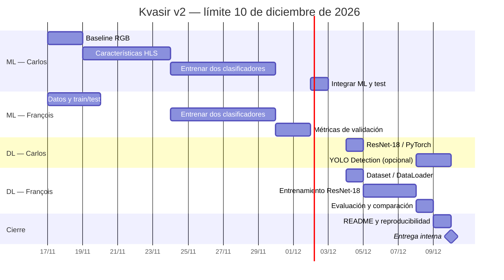

# Kvasir v2 — Tablero de trabajo

> **Objetivo del equipo:** terminar el proyecto antes del **10/12/2026**. Este documento es un **resumen estático** de los issues de GitHub, no un GitHub Project nativo. Para estados en tiempo real usa los [issues del repositorio](https://github.com/itsCarlosDev/kvasir-v2-gastrointestinal-classification/issues).

**Empezar aquí:** Carlos → [#1 Reutilizar RGB](./../../issues/1) o [#4 HLS](./../../issues/4). François → [#2 Train/test](./../../issues/2). Cada issue tiene 3 tareas concretas, un archivo que entregar y una prueba rápida. Los detalles avanzados están en [docs/CONTRATOS.md](./docs/CONTRATOS.md).

## Vista rápida por fases

| Fase | Fechas | Resultado |
|---|---|---|
| **1. Machine Learning · HLS** | 19/11–03/12 | Dataset limpio, cuatro modelos clásicos, validación cruzada, búsqueda de hiperparámetros y un test final |
| **2. Deep Learning · ResNet-18 / PyTorch** | 04/12–09/12 | CNN para las ocho clases, entrenamiento, evaluación y comparación justa con ML |
| **3. Entrega** | **10/12** | Documentación, reproducibilidad y todo integrado en `main` |
| **Opcional: YOLO Detection** | Tras lo prioritario | Solo estudio de viabilidad si no compromete la fecha límite |

## Machine Learning — primero

| Estado inicial | Issue | Responsable | Fecha límite | Rama |
|---|---|---|---|---|
| Por hacer | [#1 Reutilizar RGB](https://github.com/itsCarlosDev/kvasir-v2-gastrointestinal-classification/issues/1) | [Carlos](https://github.com/itsCarlosDev) | **19/11** | `feat/ml-carlos` |
| Por hacer | [#2 Train/test automático](https://github.com/itsCarlosDev/kvasir-v2-gastrointestinal-classification/issues/2) | [François](https://github.com/Francois0405) | **20/11** | `feat/ml-francois` |
| Por hacer | [#4 RGB → HLS circular](https://github.com/itsCarlosDev/kvasir-v2-gastrointestinal-classification/issues/4) | [Carlos](https://github.com/itsCarlosDev) | **24/11** | `feat/ml-carlos` |
| Por hacer | [#5 Dos modelos Carlos](https://github.com/itsCarlosDev/kvasir-v2-gastrointestinal-classification/issues/5) | [Carlos](https://github.com/itsCarlosDev) | **30/11** | `feat/ml-carlos` |
| Por hacer | [#13 Dos modelos François](https://github.com/itsCarlosDev/kvasir-v2-gastrointestinal-classification/issues/13) | [François](https://github.com/Francois0405) | **30/11** | `feat/ml-francois` |
| Por hacer | [#7 Gráficas y comparación](https://github.com/itsCarlosDev/kvasir-v2-gastrointestinal-classification/issues/7) | [François](https://github.com/Francois0405) | **02/12** | `feat/ml-francois` |
| Por hacer | [#14 Unir ML y evaluar test](https://github.com/itsCarlosDev/kvasir-v2-gastrointestinal-classification/issues/14) | [Carlos](https://github.com/itsCarlosDev) | **03/12** | `integration/ml` |

**Regla:** no utilizar el conjunto test para elegir características, modelos ni hiperparámetros. La evaluación ML final es el #14.

## Deep Learning — después de integrar ML

| Estado inicial | Issue | Responsable | Fecha límite | Rama futura |
|---|---|---|---|---|
| Pendiente de fase | [#10 Crear ResNet-18](https://github.com/itsCarlosDev/kvasir-v2-gastrointestinal-classification/issues/10) | [Carlos](https://github.com/itsCarlosDev) | **05/12** | `feat/dl-carlos` |
| Pendiente de fase | [#15 Preparar imágenes PyTorch](https://github.com/itsCarlosDev/kvasir-v2-gastrointestinal-classification/issues/15) | [François](https://github.com/Francois0405) | **05/12** | `feat/dl-francois` |
| Pendiente de fase | [#12 Entrenar ResNet-18](https://github.com/itsCarlosDev/kvasir-v2-gastrointestinal-classification/issues/12) | [François](https://github.com/Francois0405) | **08/12** | `feat/dl-francois` |
| Pendiente de fase | [#9 Comparar ResNet y ML](https://github.com/itsCarlosDev/kvasir-v2-gastrointestinal-classification/issues/9) | [François](https://github.com/Francois0405) | **09/12** | `feat/dl-francois` |

## Cierre y ampliación

| Estado inicial | Issue | Responsable | Fecha límite |
|---|---|---|---|
| En paralelo / finalizar | [#8 Proyecto listo para entrega](https://github.com/itsCarlosDev/kvasir-v2-gastrointestinal-classification/issues/8) | [François](https://github.com/Francois0405) | **10/12** |
| Opcional | [#11 YOLO Detection opcional](https://github.com/itsCarlosDev/kvasir-v2-gastrointestinal-classification/issues/11) | [Carlos](https://github.com/itsCarlosDev) | **10/12** |

## Cronograma visual

## Flujo de ramas y Pull Requests (sin bloqueos)

1. **Primera sincronización:** el contrato se añadió a `main` después de crear las ramas ML. Cada desarrollador hace `git fetch origin && git merge origin/main` **una vez** al empezar, para disponer del mismo documento de interfaces. No se mezcla todavía el trabajo del compañero.
2. Carlos desarrolla exclusivamente sus módulos en `feat/ml-carlos` y François en `feat/ml-francois`. Cada uno arranca sus tests con **fixtures sintéticas**; no necesita esperar al módulo real del otro.
3. La rama de integración **`integration/ml`** (ya creada) recibe los PR individuales. Si hace falta reutilizar un cambio puntual antes de la integración, acordar y aplicar un `git cherry-pick <sha>` selectivo. **No fusionar recíprocamente las dos ramas completas**, para evitar conflictos e historial circular.
4. Carlos integra y valida el conjunto en `integration/ml`. Solo al terminar ML se abre **un PR de `integration/ml` a `main`**, fecha objetivo **03/12**.
5. Crear `feat/dl-carlos`, `feat/dl-francois` y **`integration/dl`** desde la nueva `main` con ML. Repetir trabajo independiente, integración y revisión. No crear las ramas DL desde la `main` anterior al cierre de ML.
6. **10/12 fecha límite interna absoluta:** `main` debe contener el proyecto reproducible. YOLO es opcional y jamás bloquea la entrega.

### Tres contratos que evitan dependencias artificiales

- **Datos:** `metadata/splits.csv` (`image_path,class_name,split`) y `metadata/class_names.json` (ocho clases ordenadas).
- **Características:** `extract_hls_features(image_path)` devuelve siete valores numéricos mínimos; modelos trabajan con `X,y` incluso si aún no existe el extractor real.
- **Modelos y métricas:** `get_model_grids()` en ambos módulos devuelve dos pipelines con mallas de hiperparámetros; evaluación acepta etiquetas y probabilidades sin leer imágenes ni test por su cuenta.

Consulta el detalle, los formatos y pruebas autónomas en [docs/CONTRATOS.md](./docs/CONTRATOS.md).

> Los estados de esta tabla **no se actualizan automáticamente**. Para un tablero arrastrable con vistas Board, Table y Roadmap, crear un **GitHub Project** e importar los issues existentes del repositorio. No duplicar issues.
