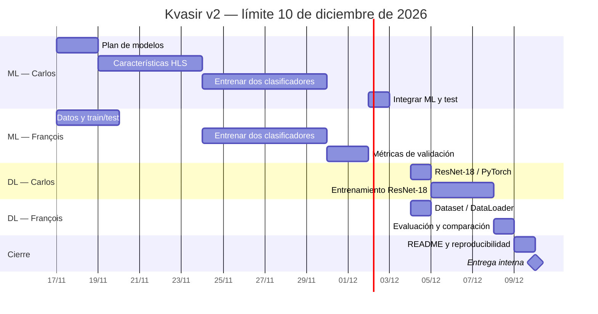

# Kvasir v2 — Tablero de trabajo

> **Objetivo del equipo:** terminar el proyecto antes del **10/12/2026**. Este documento es un **resumen estático** de los issues de GitHub, no un GitHub Project nativo. Para estados en tiempo real usa los [issues del repositorio](https://github.com/itsCarlosDev/kvasir-v2-gastrointestinal-classification/issues).

## Vista rápida por fases

| Fase | Fechas | Resultado |
|---|---|---|
| **1. Machine Learning · HLS** | 19/11–03/12 | Dataset limpio, cuatro modelos clásicos, validación cruzada, búsqueda de hiperparámetros y un test final |
| **2. Deep Learning · ResNet-18 / PyTorch** | 04/12–09/12 | CNN para las ocho clases, entrenamiento, evaluación y comparación justa con ML |
| **3. Entrega** | **10/12** | Documentación, reproducibilidad y todo integrado en `main` |
| **Opcional: YOLO Detection** | Tras lo prioritario | Solo estudio de viabilidad si no compromete la fecha límite |

## Machine Learning — primero

| Estado inicial | Issue | Responsable | Fecha límite | Rama |
|---|---|---|---|---|
| Por hacer | [#1 Plan y modelos clásicos](https://github.com/itsCarlosDev/kvasir-v2-gastrointestinal-classification/issues/1) | [Carlos](https://github.com/itsCarlosDev) | **19/11** | `feat/ml-carlos` |
| Por hacer | [#2 Datos y train/test](https://github.com/itsCarlosDev/kvasir-v2-gastrointestinal-classification/issues/2) | [François](https://github.com/Francois0405) | **20/11** | `feat/ml-francois` |
| Por hacer | [#4 Características HLS](https://github.com/itsCarlosDev/kvasir-v2-gastrointestinal-classification/issues/4) | [Carlos](https://github.com/itsCarlosDev) | **24/11** | `feat/ml-carlos` |
| Por hacer | [#5 Entrenar 2 modelos](https://github.com/itsCarlosDev/kvasir-v2-gastrointestinal-classification/issues/5) | [Carlos](https://github.com/itsCarlosDev) | **30/11** | `feat/ml-carlos` |
| Por hacer | [#13 Entrenar otros 2 modelos](https://github.com/itsCarlosDev/kvasir-v2-gastrointestinal-classification/issues/13) | [François](https://github.com/Francois0405) | **30/11** | `feat/ml-francois` |
| Por hacer | [#7 Métricas y gráficos CV](https://github.com/itsCarlosDev/kvasir-v2-gastrointestinal-classification/issues/7) | [François](https://github.com/Francois0405) | **02/12** | `feat/ml-francois` |
| Por hacer | [#14 Integración ML y test final](https://github.com/itsCarlosDev/kvasir-v2-gastrointestinal-classification/issues/14) | [Carlos](https://github.com/itsCarlosDev) | **03/12** | `feat/ml-carlos` |

**Regla:** no utilizar el conjunto test para elegir características, modelos ni hiperparámetros. La evaluación ML final es el #14.

## Deep Learning — después de integrar ML

| Estado inicial | Issue | Responsable | Fecha límite | Rama futura |
|---|---|---|---|---|
| Pendiente de fase | [#10 Modelo ResNet-18 / PyTorch](https://github.com/itsCarlosDev/kvasir-v2-gastrointestinal-classification/issues/10) | [Carlos](https://github.com/itsCarlosDev) | **05/12** | `feat/dl-carlos` |
| Pendiente de fase | [#15 Dataset / DataLoader](https://github.com/itsCarlosDev/kvasir-v2-gastrointestinal-classification/issues/15) | [François](https://github.com/Francois0405) | **05/12** | `feat/dl-francois` |
| Pendiente de fase | [#12 Entrenar ResNet-18](https://github.com/itsCarlosDev/kvasir-v2-gastrointestinal-classification/issues/12) | [Carlos](https://github.com/itsCarlosDev) | **08/12** | `feat/dl-carlos` |
| Pendiente de fase | [#9 Evaluación y comparación ML/DL](https://github.com/itsCarlosDev/kvasir-v2-gastrointestinal-classification/issues/9) | [François](https://github.com/Francois0405) | **09/12** | `feat/dl-francois` |

## Cierre y ampliación

| Estado inicial | Issue | Responsable | Fecha límite |
|---|---|---|---|
| En paralelo / finalizar | [#8 README, dependencias y reproducibilidad](https://github.com/itsCarlosDev/kvasir-v2-gastrointestinal-classification/issues/8) | [François](https://github.com/Francois0405) | **10/12** |
| Opcional | [#11 Viabilidad de YOLO Detection](https://github.com/itsCarlosDev/kvasir-v2-gastrointestinal-classification/issues/11) | [François](https://github.com/Francois0405) | **10/12** |

## Cronograma visual

## Flujo de ramas y Pull Requests

1. Carlos trabaja en `feat/ml-carlos` y François en `feat/ml-francois`, en archivos separados.
2. Cada persona termina sus issues ML y abre PR hacia `main`. Revisar los dos PR antes de integrarlos.
3. Fusionar los PR uno a uno; actualizar la segunda rama desde `main` si es necesario. **ML integrado a más tardar el 03/12.**
4. Crear `feat/dl-carlos` y `feat/dl-francois` **desde la `main` actualizada**.
5. Repetir revisión e integración para DL. Reservar el **10/12** para pruebas de ejecución y entrega.

> Los estados de esta tabla **no se actualizan automáticamente**. Para un tablero arrastrable con vistas Board, Table y Roadmap, crear un **GitHub Project** e importar los issues existentes desde el repositorio. No duplicar issues.
